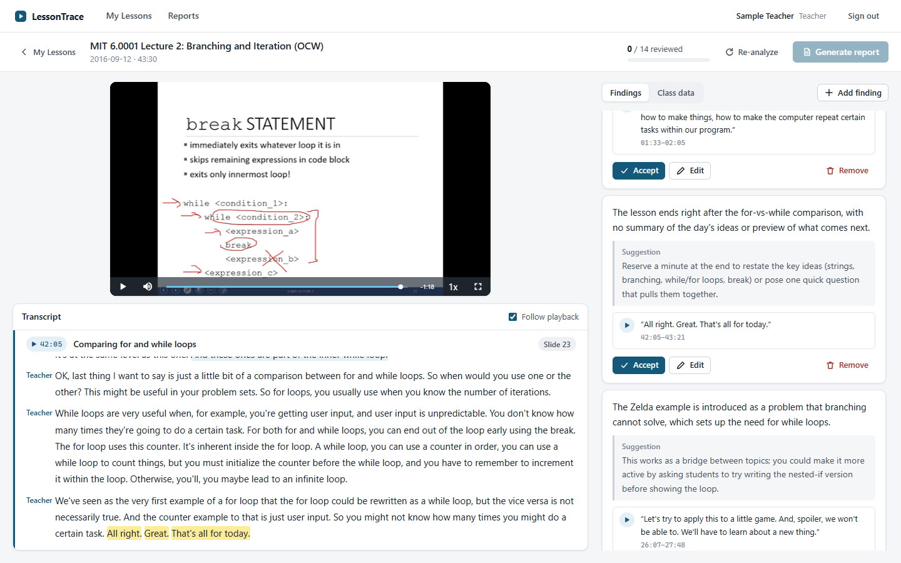
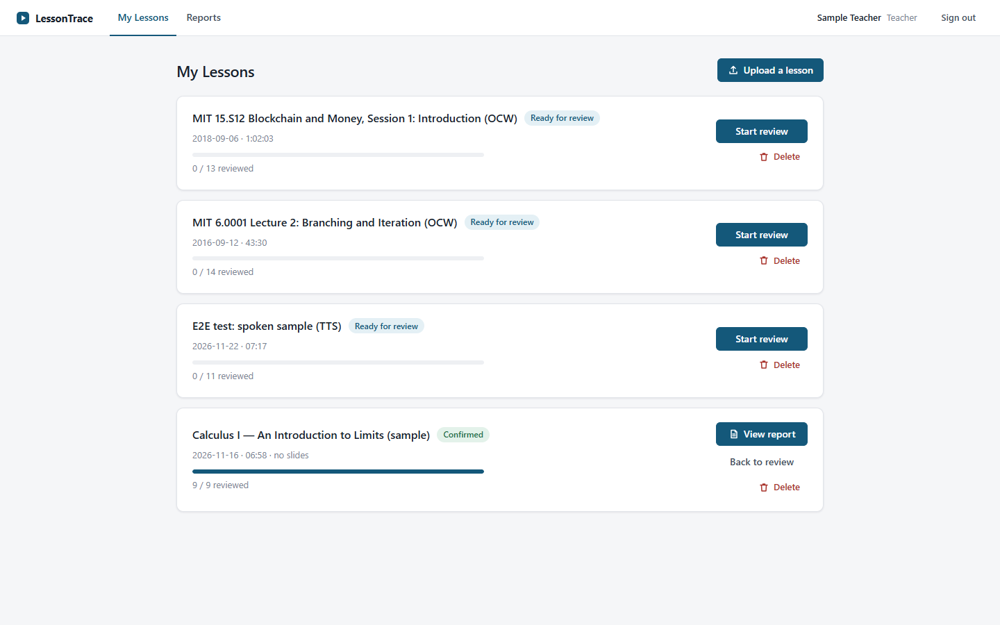
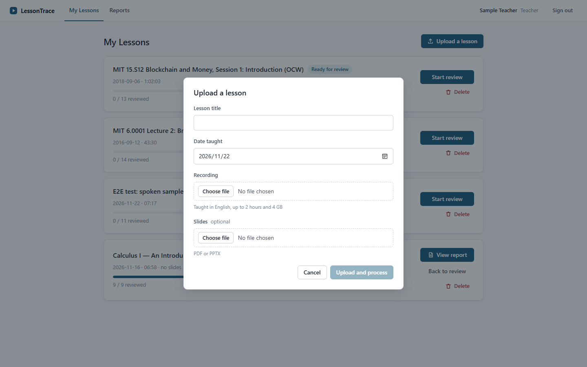
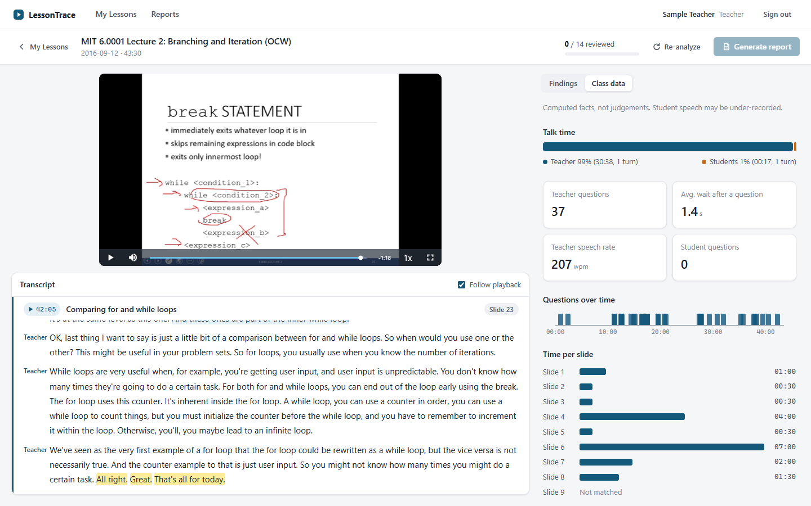
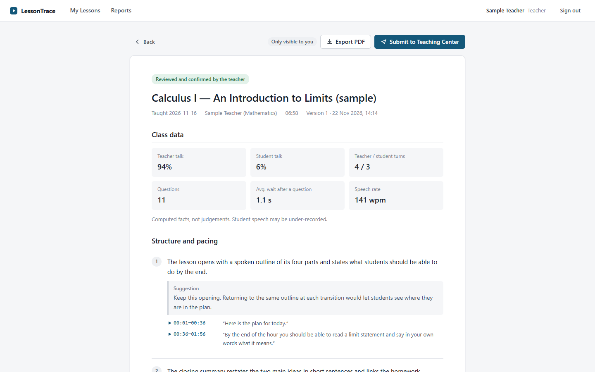
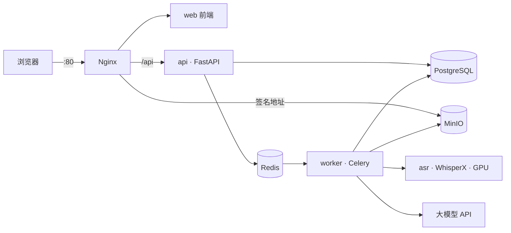
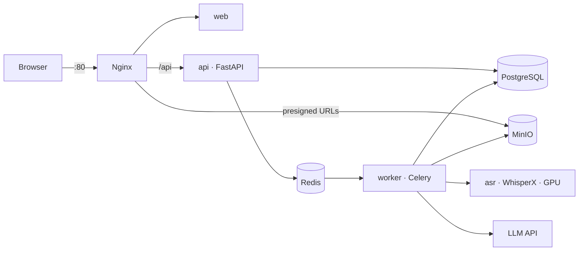

# LessonTrace

作者：陈实当

**中文** · [English](#english)

LessonTrace 把一节课的录像和课件变成带时间戳的文字稿和一组分析条目，老师对照录像逐条审阅后形成报告。

- **证据可追溯**：每条分析都引用一个录像片段和一段原文引文，点击即可播放。引用由程序校验，不通过的条目不会展示。
- **不打分**：任何地方都没有分数、等级、排名字段，模型输出还要过一遍打分表述过滤。
- **老师决定**：条目逐条采纳、修改或删除，报告只包含老师保留的内容。



文档：[技术文档](docs/technical-documentation.md)（中英双语）· [设计方案](docs/design-proposal.md)（中英双语）

## 界面

| | |
| --- | --- |
|  登录 |  课程列表与处理状态 |
|  上传录像和课件 |  从文字稿统计的课堂数据 |
|  报告 | |

界面语言为英文。

## 工作原理



一节课依次经过三个阶段，每个阶段是一个独立的队列任务，可以单独重试：

| 阶段 | 做什么 |
| --- | --- |
| 转写（Transcribe） | FFmpeg 抽音轨并生成 HLS 播放流；WhisperX 识别语音、做词级对齐、区分说话人 |
| 切分（Segment） | 把课件对齐到文字稿，把整节课切成 30 秒到 3 分钟的片段，计算统计数据 |
| 分析（Analyze） | 大模型写出引用片段的分析条目；七条确定性规则校验每一处引用 |

## 快速开始

前提：Docker 与 Compose；显存 4 GB 以上的 NVIDIA 显卡、显卡驱动和 NVIDIA Container Toolkit。

```powershell
Copy-Item .env.example .env
```

编辑 `.env`：改掉三处 `change-me`，再填 `ANTHROPIC_API_KEY`（大模型分析）和 `HF_TOKEN`（说话人分离；需先在 Hugging Face 上同意 [pyannote/speaker-diarization-community-1](https://huggingface.co/pyannote/speaker-diarization-community-1) 的使用协议）。

```powershell
docker compose up -d --build
```

浏览器打开 <http://localhost>。首次启动会自动建库、建三个账号、导入一节示例课。

- 账号是 `teacher`、`center`、`admin`，口令取自 `.env` 的 `INIT_*_PASSWORD`；留空则随机生成，只在 `docker compose logs api` 里打印一次。
- 首次构建较慢：MinIO 从源码编译（约 5–10 分钟），`asr` 镜像要下载带 CUDA 的 PyTorch（约 8 GB）。
- 没有显卡或密钥时，可以只启动转写以外的服务。示例课照样能审阅，新上传的课会在第一阶段失败。

```powershell
docker compose up -d --build nginx web api worker postgres redis minio
```

**GPU 排查**：如果 `docker compose logs asr` 显示 `No usable GPU … running on CPU`，而容器里 `nvidia-smi` 正常，说明 WSL 或 Docker Desktop 相对显卡驱动太旧。在管理员 PowerShell 里执行 `wsl --update`，重启 Docker Desktop 后再试。

## 使用

1. **上传**录像（英语授课，不超过 2 小时、4 GB），课件可选（PDF 或 PPTX）。
2. **等待**，卡片会显示当前阶段，处理完自动变为可审阅。
3. **审阅**：点证据播放对应片段，文字稿滚动到引文处。逐条采纳、修改或删除；在文字稿上选中文字可以新增自己的条目。
4. 全部处理完后**生成报告**，可导出 PDF，可选择提交给教学发展中心。

| 角色 | 能做什么 |
| --- | --- |
| 老师 | 以上全部，仅限自己的课 |
| 教学发展中心 | 查看老师已提交的报告 |
| 管理员 | 管理账号、查看访问日志、重试失败的任务；看不到课程内容 |

## 真实公开课上的结果

两节 MIT OpenCourseWare 的课（CC BY-NC-SA，带课件），`medium` 转写模型，`claude-opus-5-5`，开启说话人分离。参考文本是录像文件自带的字幕轨，没有人工校对。

| 指标 | 6.0001 Lecture 2（Python，43.5 分钟） | 15.S12 Session 1（区块链，62 分钟） | 目标 |
| --- | --- | --- | --- |
| 词错率（第 10–20 分钟） | 4.5% | 6.0% | ≤ 10% |
| 跳转落点在引文 2 秒内的证据 | 17 / 19 | 22 / 24 | 全部 |
| 引用有效率 | 100%（19 / 19） | 100%（28 / 28） | ≥ 95% |
| 展示给老师的打分表述 | 0 | 0 | 0 |
| 通过校验的条目 | 14 | 13 | — |
| 对齐上的课件页数 | 20 / 24 | 28 / 43 | — |
| 老师 / 学生说话时长 | 30:38 / 0:17 | 47:22 / 2:10 | — |
| 证据支撑率 | 11 / 14 | 12 / 13 | ≥ 85% |

处理耗时（RTX 3050 Ti 4 GB，模型已缓存）：

| | 43.5 分钟的课 | 62 分钟的课 |
| --- | --- | --- |
| 转写，不开说话人分离 | 3 分 09 秒 | 4 分 25 秒 |
| 转写，开说话人分离 | 约 6.5 分钟（含一次性的模型下载） | 8 分 08 秒 |
| 切分 + 分析 | 约 40 秒 | 约 1 分钟 |

开启说话人分离时显存峰值 3.9 GB。

怎么读这些数字：

- 只有两节课、各跑一轮，模型输出每次不同；这是一次摸底，不是达标结论。
- 证据支撑率是人工逐条判断的，合计 23 / 27（85.2%）。逐条理由见[评估记录](docs/evidence-support-evaluation.md)。
- 跳转提前超过 2 秒的证据，都是引文从一句话的中间开始，播放从句首起跳，落点仍在讲话中。
- 词错率略偏保守：文字稿把数字拼成单词，字幕用的是阿拉伯数字。
- 讲台收音的录像里学生声音很小，学生说话时长只是下限。

## 示例课

`backend/samples/limits_intro.json` 是为本项目写的一节 7 分钟的**合成课**，不是真实课堂。文字稿是手写的，录像由 FFmpeg 生成、画面显示当前句子和时间码，9 条条目是手写的但要过同一套证据校验。重新导入：

```powershell
docker compose exec api python -m scripts.seed_demo --force
```

仓库不提交录像文件。上面两节课在 [ocw.mit.edu](https://ocw.mit.edu) 上，下载后放到 `test-data/`（已在 `.gitignore` 里）。

## 测试

```powershell
docker compose run --rm --no-deps api python -m pytest tests -q
```

100 个用例，覆盖证据校验的每条规则、切分边界、状态机重试、权限、审阅与报告。设计方案要求测试用例由人来定；这些用例是按方案里的清单写的，请过一遍。

里程碑 1 的命令行闭环不需要数据库：

```powershell
docker compose run --rm --no-deps api python -m app.cli analyze samples/segments_example.json
```

## 现状

| 项 | 状态 |
| --- | --- |
| 一条命令启动全部服务 | 开发机上是；没有在干净克隆里验证过 |
| 转写在 GPU 上运行 | 是 |
| 从浏览器走完「上传到报告」 | 上传、处理、审阅在两节真实公开课上验证过；生成报告、导出 PDF、提交在示例课上验证过 |
| 说话人分离 | 可用；累计说话最长的人标为老师 |
| 带人工标注的基准集 | 未做 |
| 操作录屏 | 未做 |
| 大模型提供方 | 只有 Anthropic |

与设计方案的出入：

| 设计方案 | 实际 | 原因 |
| --- | --- | --- |
| `minio/minio` 镜像 | `minio/Dockerfile` 从官方源码构建 | 官方镜像在 Docker Hub 和 quay.io 上都已拉不到 |
| API 表 | 多了登录、课程列表、重新分析、报告查看与 PDF、HLS 播放列表 | 方案描述的功能需要这些接口 |
| 文字稿里的数字 | 拼成单词 | 阿拉伯数字无法词级对齐，会带偏后面的时间戳 |
| 中文界面 | 英文 | 第一版之后按要求改的 |

---

# English

Author: CHEN SHIDANG

[中文](#lessontrace) · **English**

LessonTrace turns the recording and slides of one lesson into a time-stamped transcript and a set of findings. The teacher reviews each finding against the recording and the result becomes a report.

- **Traceable evidence.** Every finding cites a segment of the recording and a verbatim quote. One click plays it. Citations are checked by code, and findings that fail the check are never shown.
- **No scores.** There are no score, grade or rank fields anywhere, and model output is filtered for scoring language.
- **The teacher decides.** Findings are accepted, edited or removed one by one. The report contains only what the teacher kept.


Documentation: [Technical documentation](docs/technical-documentation.md) (bilingual) · [Design proposal](docs/design-proposal.md) (bilingual)

## Screens

| | |
| --- | --- |
|  Sign in |  Lessons and processing status |
|  Upload a recording and slides |  Class data computed from the transcript |
|  Report | |

## How it works



A lesson moves through three stages, each a separate queue task that can be retried on its own:

| Stage | What happens |
| --- | --- |
| Transcribe | FFmpeg extracts audio and builds an HLS stream. WhisperX recognises speech, aligns words and separates speakers. |
| Segment | Slides are matched to the transcript, the lesson is cut into 30-second to 3-minute segments, and statistics are computed. |
| Analyze | An LLM writes findings that cite segments; seven deterministic rules validate every citation. |

## Quick start

Requirements: Docker with Compose, an NVIDIA GPU with 4 GB of memory or more, the NVIDIA driver and the NVIDIA Container Toolkit.

```powershell
Copy-Item .env.example .env
```

Edit `.env`: replace the three `change-me` values, then set `ANTHROPIC_API_KEY` (LLM analysis) and `HF_TOKEN` (speaker separation; first accept the terms of [pyannote/speaker-diarization-community-1](https://huggingface.co/pyannote/speaker-diarization-community-1) on Hugging Face).

```powershell
docker compose up -d --build
```

Open <http://localhost>. The first start creates the database, three accounts and one sample lesson.

- Accounts are `teacher`, `center` and `admin`. Passwords come from `INIT_*_PASSWORD` in `.env`; if left empty they are generated and printed once in `docker compose logs api`.
- The first build is slow: MinIO is compiled from source (about 5–10 minutes) and the `asr` image downloads PyTorch with CUDA (about 8 GB).
- To run without a GPU or keys, start everything except transcription. The sample lesson can still be reviewed; new uploads will fail at the first stage.

```powershell
docker compose up -d --build nginx web api worker postgres redis minio
```

**GPU troubleshooting.** If `docker compose logs asr` says `No usable GPU … running on CPU` while `nvidia-smi` works inside the container, WSL or Docker Desktop is too old for the GPU driver. Run `wsl --update` in an administrator PowerShell, restart Docker Desktop and try again.

## Using it

1. **Upload** a recording (English, up to 2 hours and 4 GB) and optionally slides (PDF or PPTX).
2. **Wait** while the card shows the current stage. It becomes reviewable by itself.
3. **Review.** Click evidence to play that segment; the transcript scrolls to the quote. Accept, edit or remove each finding. Select text in the transcript to add your own finding.
4. **Generate the report** once every finding is handled. Export it as PDF, and submit it to the Teaching Center if you choose.

| Role | Can do |
| --- | --- |
| Teacher | Everything above, for their own lessons only |
| Teaching Center | Read reports that teachers have submitted |
| Admin | Manage accounts, read the access log, retry failed tasks; cannot see lesson content |

## Results on real lectures

Two MIT OpenCourseWare lectures (CC BY-NC-SA, with slides), `medium` recognition model, `claude-opus-5-5`, speaker separation on. Reference text is the caption track embedded in each video file, not a human-checked transcript.

| Metric | 6.0001 Lecture 2 (Python, 43.5 min) | 15.S12 Session 1 (Blockchain, 62 min) | Target |
| --- | --- | --- | --- |
| Word error rate, minutes 10–20 | 4.5% | 6.0% | ≤ 10% |
| Evidence that seeks within 2 s of the quote | 17 / 19 | 22 / 24 | all |
| Citation validity | 100% (19 / 19) | 100% (28 / 28) | ≥ 95% |
| Scoring language shown to the teacher | 0 | 0 | 0 |
| Findings that passed validation | 14 | 13 | — |
| Slides matched to the transcript | 20 / 24 | 28 / 43 | — |
| Teacher / student talk time | 30:38 / 0:17 | 47:22 / 2:10 | — |
| Evidence support rate | 11 / 14 | 12 / 13 | ≥ 85% |

Processing time on an RTX 3050 Ti (4 GB), models cached:

| | 43.5-minute lecture | 62-minute lecture |
| --- | --- | --- |
| Transcribe, without speaker separation | 3 min 09 s | 4 min 25 s |
| Transcribe, with speaker separation | about 6.5 min (included a one-time model download) | 8 min 08 s |
| Segment + analyze | about 40 s | about 1 min |

Peak GPU memory with speaker separation was 3.9 GB.

How to read this:

- This is one run on two lectures. Model output varies between runs, so treat it as a first look, not proof that the targets are met.
- The evidence support rate was judged by a person, finding by finding: 23 / 27 overall (85.2%). Per-finding reasons are in the [evaluation record](docs/evidence-support-evaluation.md).
- Evidence that seeks more than 2 seconds early starts in the middle of a sentence; playback begins at the sentence start, still within speech.
- Word error rate is slightly pessimistic: the transcript spells numbers out while the captions use digits.
- Student voices are faint in lectern-miked recordings, so student talk time is a lower bound.

## Sample lesson

`backend/samples/limits_intro.json` is a **synthetic** 7-minute lesson written for this project, not a real class. The transcript is hand-written, the video is generated by FFmpeg and shows the current sentence with a timecode, and the nine findings are hand-written but pass through the same evidence validation as model output. Re-import it with:

```powershell
docker compose exec api python -m scripts.seed_demo --force
```

Recordings are not committed to the repository. The two lectures above are on [ocw.mit.edu](https://ocw.mit.edu); place downloads under `test-data/`, which is git-ignored.

## Tests

```powershell
docker compose run --rm --no-deps api python -m pytest tests -q
```

100 cases cover every evidence rule, segmentation edge cases, state machine retries, permissions, review and reports. The design proposal asks that test cases be chosen by a person; these were written from its checklist and should be reviewed.

The command-line loop from milestone 1 needs no database:

```powershell
docker compose run --rm --no-deps api python -m app.cli analyze samples/segments_example.json
```

## Status

| Item | Status |
| --- | --- |
| One command starts everything | Yes on the development machine; not verified from a clean clone |
| Transcription runs on the GPU | Yes |
| Upload → report from the browser | Upload, processing and review verified on two real lectures; report generation, PDF export and submission verified on the sample lesson |
| Speaker separation | Works; the teacher is the speaker with the most talk time |
| Benchmark set with human annotation | Not done |
| Screen recording | Not done |
| LLM providers | Anthropic only |

How the implementation differs from the design proposal:

| Design proposal | As built | Why |
| --- | --- | --- |
| `minio/minio` image | Built from the official source in `minio/Dockerfile` | The official images are no longer available on Docker Hub or quay.io |
| API table | Adds login, lesson list, re-analyze, report read and PDF, HLS playlist | Needed by the features the proposal describes |
| Numbers in the transcript | Spelled out as words | Digits cannot be word-aligned and shift later timestamps |
| Chinese interface text | English | Requested after the first version |
