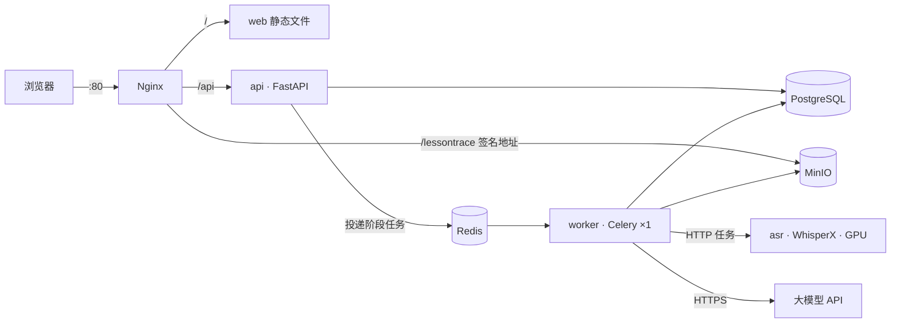
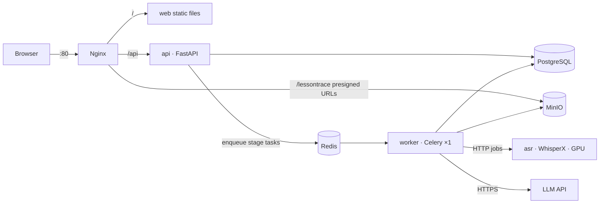

# LessonTrace 技术文档 · Technical Documentation

本文档描述 LessonTrace 的**实际实现**：用了哪些技术、各模块怎么工作、怎么部署和验证。设计意图和取舍见 [design-proposal.md](design-proposal.md)。

This document describes LessonTrace **as built**: the technologies used, how each module works, and how it is deployed and verified. For design intent and trade-offs see [design-proposal.md](design-proposal.md).

- [中文](#中文)
- [English](#english)

---

# 中文

作者：陈实当

## 1. 系统概述

LessonTrace 把一节课的录像和课件变成带时间戳的文字稿和一组分析条目，老师逐条审阅后形成报告。两条约束贯穿实现：

- **证据可追溯**：每条分析至少引用一个录像片段和一段原文引文。引用由确定性程序校验，不通过的条目不会展示。
- **不自动打分**：数据表和模型输出结构里都没有分数、等级、排名字段；模型输出还要过一遍打分表述过滤。

界面语言为英文；分析条目用英文书写（与授课语言一致）。

## 2. 技术栈

### 2.1 后端（`backend/`，Python 3.12）

| 技术 | 版本 | 用途 |
| --- | --- | --- |
| FastAPI | 0.165.0 | HTTP 接口，请求校验，OpenAPI 文档（`/api/docs`） |
| Starlette / Uvicorn | 1.10.0 / 0.54.0 | ASGI 框架与服务器 |
| Pydantic / pydantic-settings | 2.14.4 / 2.16.3 | 请求体模型；从 `.env` 读取配置 |
| SQLAlchemy | 2.0.58 | ORM（同步会话），JSONB 列 |
| psycopg | 3.3.9 | PostgreSQL 驱动 |
| Celery | 5.7.0 | 异步阶段任务、重试、超时 |
| redis（客户端） | 8.1.0 | Celery 的消息代理连接 |
| boto3 | 1.44.9 | 访问 S3 兼容的对象存储，生成签名地址 |
| PyJWT | 2.15.1 | 登录令牌和播放令牌（HS256） |
| bcrypt | 5.0.0 | 口令哈希 |
| jsonschema | 4.26.0 | 校验模型输出结构（规则 1） |
| RapidFuzz | 3.14.6 | 引文模糊匹配（规则 4） |
| anthropic | 2.12.0 | 大模型 API 客户端（结构化输出） |
| PyMuPDF | 2.1 | 解析 PDF 课件 |
| python-pptx | 1.0.2 | 解析 PPTX 课件 |
| ReportLab | 5.1.0 | 生成报告 PDF |
| httpx | 0.28.1 | 调用语音转写服务 |
| PyYAML | 6.0.4 | 读取分析维度配置 |
| FFmpeg / ffprobe | 7.1.5 | 抽音轨、转 HLS、探测媒体信息 |
| pytest | 9.2.0 | 自动化测试（100 个用例） |

依赖由 `uv pip compile` 从 `requirements.in` 锁定到 `requirements.txt`。

### 2.2 语音转写服务（`asr/`，Python 3.12，GPU）

| 技术 | 版本 | 用途 |
| --- | --- | --- |
| WhisperX | 3.8.6 | 转写流程：语音活动检测、识别、词级对齐、说话人分配 |
| faster-whisper / CTranslate2 | 1.2.1 / 4.9.0 | Whisper 推理引擎（`medium` 模型，`int8_float16`） |
| wav2vec 2.0（torchaudio） | 2.8.0 | 英语词级强制对齐 |
| pyannote.audio | 4.1.1 | 说话人分离（`speaker-diarization-community-1`） |
| PyTorch | 2.8.0（CUDA 12.8） | 深度学习运行时 |
| FastAPI / Uvicorn | 0.165.0 / 0.54.0 | 任务接口 `POST /jobs`、`GET /jobs/{id}` |

### 2.3 前端（`frontend/`）

| 技术 | 版本 | 用途 |
| --- | --- | --- |
| Vue | 3.5.46 | 界面框架（`<script setup>` 单文件组件） |
| TypeScript | 6.0.3 | 类型检查（`vue-tsc` 3.3.14） |
| Vue Router | 4.6.5 | 路由与按角色跳转 |
| video.js | 8.24.2 | 播放器，内置 HLS 播放 |
| Vite | 8.3.8 | 构建工具 |

没有使用 UI 组件库和状态管理库；样式是手写的 CSS 变量体系，图标是内联 SVG。

### 2.4 基础设施

| 技术 | 版本 | 用途 |
| --- | --- | --- |
| Docker Compose | — | 一条命令启动 8 个服务 |
| Nginx | 1.28.0 | 唯一对外入口；反向代理接口、前端和对象存储 |
| PostgreSQL | 17.7 | 业务数据 |
| Redis | 7.4.2 | 任务队列 |
| MinIO | RELEASE.2025-09-07 | S3 兼容对象存储（从官方源码构建，Go 1.24） |
| NVIDIA Container Toolkit | — | 容器内使用 GPU |

### 2.5 外部服务

| 服务 | 用途 | 发送的数据 |
| --- | --- | --- |
| Anthropic API（`claude-opus-5-5`） | 写分析条目和片段标题 | 只有文字稿和课件文字，不含音视频 |
| Hugging Face Hub | 首次运行时下载转写、对齐、分离模型 | 无课程数据 |

## 3. 架构



- 只有 Nginx 映射宿主机端口，其余服务只在容器网络内可达。
- 录像由浏览器用签名地址直传对象存储，不经过 `api` 进程。
- 模块之间只通过数据库记录交接；每个处理阶段是一个独立的队列任务，可以单独重跑。
- `worker` 只开一个进程，课程排队依次处理（单 GPU）。

## 4. 目录结构

```
backend/app/
  main.py  config.py  db.py  models.py  security.py  storage.py  queue.py  worker.py
  api/        auth.py lessons.py review.py reports.py admin.py
  pipeline/   media.py slides.py segmenter.py metrics.py speakers.py stages.py
  analysis/   llm.py prompts.py schema.py validator.py runner.py
  report_pdf.py  cli.py
backend/config/dimensions.yaml     分析维度
backend/scripts/                   init_db.py seed_demo.py wer.py
backend/samples/                   合成示例课
backend/tests/                     100 个用例
asr/server.py                      转写服务
frontend/src/                      views/ components/ api.ts main.ts style.css
nginx/conf.d/default.conf
minio/Dockerfile
docker-compose.yml  .env.example
```

## 5. 数据模型

所有时间用毫秒整数；`findings` 没有任何分数字段；证据的时间永远从 `segments` 查，不存模型给的时间。

| 表 | 关键字段 | 说明 |
| --- | --- | --- |
| `users` | username, password_hash, name, role, dept, active | role：teacher / center / admin |
| `lessons` | teacher_id, title, taught_on, video_key, slides_key, duration_ms, status, error, queued_at | 一节课，也是一个处理任务 |
| `sentences` | lesson_id, idx, start_ms, end_ms, speaker, text | 句级转写；speaker：teacher / student / unknown |
| `slides` | lesson_id, page_no, text, start_ms, end_ms | 未对齐时时间为空 |
| `segments` | lesson_id, code, start_ms, end_ms, slide_id, title, sentence_from, sentence_to | code 形如 S012；句子范围存序号 |
| `metrics` | lesson_id, key, value(JSON), segment_id | segment_id 为空表示整节课 |
| `analysis_runs` | lesson_id, model, prompt_version, raw_output, stats, status | 每次模型调用留痕 |
| `findings` | run_id, lesson_id, dimension, observation, suggestion, status, source | status：draft / accepted / edited / rejected |
| `finding_evidence` | finding_id, segment_id, quote | 一条可有多个 |
| `review_actions` | finding_id, user_id, action, before, after, at | 只增不改 |
| `reports` | lesson_id, version, content(JSON), pdf_key, submitted_at | 生成时的快照 |
| `audit_logs` | user_id, action, target_type, target_id, ip, at | 只增不改，不设外键 |

删除课程时由数据库外键级联删除全部记录，并清掉对象存储里该课程前缀下的所有文件。

## 6. 处理流水线

### 6.1 状态机

`uploaded → transcribing → segmenting → analyzing → ready → confirmed`，三个处理状态都可进入 `failed`。实现在 `pipeline/stages.py` 的 `run_stage`：

- 状态不是本阶段时任务直接跳过，所以重复投递是安全的。
- 阶段开始先清掉本阶段的旧产物；产物写入数据库后才更新状态并投递下一阶段。
- 出错自动重试 3 次，间隔 30 秒、2 分钟、8 分钟；仍失败则记录 `error = {stage, reason}`。
- 配置错误（缺密钥）和不可恢复的错误（文件损坏、超时长）不重试，直接失败。
- 每阶段有 Celery 软超时：转写 3 小时，切分 20 分钟，分析 30 分钟。
- 手动重试从记录的失败阶段继续，前面阶段的结果保留。
- 重新分析：`ready → analyzing`，只替换未处理的模型草稿。

### 6.2 阶段一：预处理与转写

1. `ffprobe` 读时长和编码；超过 2 小时直接失败。
2. FFmpeg 抽第一路音轨为 16 kHz 单声道 WAV。
3. FFmpeg 生成 HLS（4 秒分片）。H.264 + AAC 的源直接换封装，否则用 libx264 转码。显式只取第一路视频和音频，忽略封面图流和字幕流。
4. 从课件文字里抽取术语（较长、重复出现或首字母大写的词，最多 60 个）作为识别提示词。
5. 调用转写服务。服务内依次执行并在每步之后释放显存：
   - Whisper `medium` 识别，开启 `suppress_numerals`（数字拼成单词，否则无法词级对齐）。
   - wav2vec 2.0 词级对齐。
   - pyannote 说话人分离，并把说话人分配到词和句。
   - 后处理：一句话中间有 ≥ 2 秒停顿时按词级时间拆开；折叠重复幻觉（同一短语连续 ≥ 4 遍且总长 ≥ 12 词）。
6. 累计说话时长最长的说话人标为 teacher，其余标为 student；没有分离结果时标为 unknown。

实测（RTX 3050 Ti 4 GB）：62 分钟的课，转写阶段不开说话人分离 4 分 25 秒，开启后 8 分 08 秒；显存峰值 3.9 GB。

### 6.3 阶段二：课件对齐、片段切分、规则统计

**课件对齐**（`pipeline/slides.py`）：

- 把文字稿按 30 秒切成时间窗口，对每页课件和每个窗口算 TF-IDF 余弦相似度。
- 动态规划为每个窗口选一页，使总相似度最大；往回翻一页代价 0.25，每跳过一页代价 0.01，实现「页码大体递增」。
- 每页取被分配到的最长连续窗口段作为讲解时间；平均相似度低于 0.08 的页标记为未对齐。

**片段切分**（`pipeline/segmenter.py`）：

- 切点：翻页（强度 3）、≥ 2 秒的停顿（2）、师生说话人切换（1）。
- 先在所有切点切开；再反复把最短的片段并入边界较弱的一侧，直到都不短于 30 秒；最后把长于 3 分钟的片段在最长的停顿处再切。
- 片段编号 S001、S002……；标题由大模型生成，只用于展示，模型不可用时留空。

**规则统计**（`pipeline/metrics.py`）：师生说话时长与占比、话轮数、语速（词/分钟）、提问次数与位置（句末问号或疑问词/助动词开头）、提问后等待时长、每页课件停留时长。没有说话人分离时，提问和语速按全部发言统计，占比留空。统计只作为事实，不设阈值。

### 6.4 阶段三：大模型分析与证据校验

见第 7、8 节。

## 7. 大模型分析

- **适配层**（`analysis/llm.py`）：`LLMClient` 协议只有一个方法 `complete_json(system, user, schema) -> str`。目前实现了 Anthropic，用 `output_config.format` 的 JSON Schema 约束输出，并开启服务端拒答回退。换模型提供方只需实现这个协议并登记到 `PROVIDERS`。
- **输入**：全部片段（编号、说话人、文本）、每页课件文字及对应片段、规则统计摘要、维度定义。超过 14000 词的课按维度分次调用。
- **输出结构**（`analysis/schema.py`）：`findings[] {dimension, observation, suggestion, evidence[] {segment_id, quote}}`，`additionalProperties: false`，没有地方写分数或时间。
- **提示词**（`analysis/prompts.py`，版本号 `PROMPT_VERSION`）：只描述发生了什么并给出可操作建议；每条至少一个逐字引文；找不到证据就不写；不打分、不比较；每维度最多 5 条；用英文书写。
- **留痕**：模型名、提示词版本、每次调用的原始输出和校验计数写入 `analysis_runs`，失败的调用也记录。
- **维度**（`config/dimensions.yaml`）：Structure and pacing、Questioning and interaction、Clarity of explanation、Alignment with slides。课件一页都没对齐上时跳过最后一个并记录原因。

## 8. 证据校验

全部是确定性程序（`analysis/validator.py`），不调用模型。

| 规则 | 检查 | 不通过时 |
| --- | --- | --- |
| 1 结构合法 | JSON Schema | 整次调用重试，最多 3 次 |
| 2 维度合法 | 属于已配置维度 | 丢弃条目 |
| 3 片段存在 | `segment_id` 在本节课内 | 丢弃该证据 |
| 4 引文匹配 | 归一化后是片段文本的子串；否则 RapidFuzz `partial_ratio ≥ 90` | 丢弃该证据 |
| 5 至少一条证据 | 统计有效证据 | 退回重写一次，仍失败丢弃 |
| 6 无打分表述 | 正则：score、grade、rating、rank、N/10、与他人比较等 | 退回重写一次，仍失败丢弃 |
| 7 去重 | 同维度且证据片段集合相同 | 合并 |

- 规则 6 先去掉课堂内容里的正常说法（`grade weights`、`final grade`、`grade 9`），再匹配。
- 通过后从片段表查出证据起止时间，并在片段内定位引文所在的句子，用于精确高亮。
- 每条规则拦下的数量和引用有效率写入 `analysis_runs.stats`。

## 9. 接口

统一前缀 `/api`，除登录外都要带 `Authorization: Bearer <token>`。每个接口都按角色和课程归属校验；访问别人的课返回 404。

| 方法 | 路径 | 角色 | 说明 |
| --- | --- | --- | --- |
| POST | `/auth/login` | — | 登录 |
| GET | `/auth/me` | 全部 | 当前用户 |
| GET / POST | `/lessons` | 老师（管理员只读任务状态） | 列表 / 创建并返回直传签名地址 |
| POST | `/lessons/{id}/start` | 老师 | 上传完成，开始处理 |
| GET / DELETE | `/lessons/{id}` | 老师 | 状态与进度 / 删除全部数据 |
| POST | `/lessons/{id}/retry` | 老师、管理员 | 从失败阶段重试 |
| POST | `/lessons/{id}/reanalyze` | 老师 | 重新分析 |
| GET | `/lessons/{id}/video` | 老师 | 播放地址（带短期令牌） |
| GET | `/lessons/{id}/hls/index.m3u8` | 播放令牌 | 播放列表，分片为签名地址 |
| GET | `/lessons/{id}/transcript`、`/segments`、`/metrics`、`/findings` | 老师 | 文字稿、片段、统计、条目 |
| PATCH | `/sentences/{id}` | 老师 | 修正文字或说话人 |
| POST | `/lessons/{id}/findings` | 老师 | 新增条目（证据同样校验） |
| PATCH | `/findings/{id}` | 老师 | `accept` / `reject` / `edit` |
| POST | `/lessons/{id}/report` | 老师 | 生成报告（有未处理条目时 409） |
| GET | `/reports`、`/reports/{id}`、`/reports/{id}/pdf` | 老师、中心 | 中心只能看已提交的 |
| POST | `/reports/{id}/submit` | 老师 | 提交给中心 |
| GET | `/dimensions` | 全部 | 分析维度 |
| GET / POST | `/users`，PATCH `/users/{id}` | 管理员 | 账号管理 |
| GET | `/audit-logs` | 管理员 | 按用户和时间筛选 |

## 10. 前端

- 页面：登录、我的课（含上传）、审阅、报告列表、报告、账号、访问日志、处理任务。路由按角色跳转；真正的权限校验在服务端。
- 上传：`XMLHttpRequest` 用签名地址 `PUT` 文件并显示进度，完成后调用 `start`；失败则删除空壳课程。
- 状态：课程列表每 4 秒轮询一次，仅在有课处理中时请求。
- 审阅页的联动：
  - 点证据 → 播放器跳到片段起点并播到片段终点自动停；文字稿滚动到引文所在句并高亮，播到该句后恢复跟随。
  - 点句子 → 跳到该句；当前播放的句子和片段高亮。
  - 在文字稿上选中文字 → 浮出按钮，新增条目或加入正在编辑的条目的证据（不能跨片段）。
  - 句尾的铅笔按钮 → 修正文字和说话人，之后统计自动重算。
- 登录令牌存在 `localStorage`；401 时清除并回到登录页。

## 11. 权限与隐私

- 口令用 bcrypt 哈希；登录令牌有效期 12 小时；账号停用后旧令牌立即失效。
- 老师只能访问自己的课；中心只能访问已提交的报告；管理员看不到课程名称和内容。
- 对象存储不开放公开读；播放和下载都用短期签名地址；播放令牌只对一节课有效。
- 只区分老师和学生，不做人脸或声纹识别，不记录学生姓名。
- 发给大模型的只有文字稿和课件文字。
- 登录（含失败）、查看课程和报告、提交、删除等操作写入审计日志。

## 12. 部署与配置

`docker compose up -d --build` 启动全部服务，浏览器访问 `http://localhost`。`api` 容器启动时自动建表、建桶、建三个初始账号、导入示例课。

| 变量 | 说明 |
| --- | --- |
| `PUBLIC_BASE_URL`、`HTTP_PORT` | 浏览器入口；签名地址按它生成 |
| `POSTGRES_USER` / `POSTGRES_PASSWORD` / `POSTGRES_DB` | 数据库 |
| `MINIO_ROOT_USER` / `MINIO_ROOT_PASSWORD` / `S3_BUCKET` | 对象存储 |
| `JWT_SECRET` | 令牌签名密钥 |
| `INIT_TEACHER_PASSWORD` 等 | 初始账号口令，留空则随机生成并打印一次 |
| `LLM_PROVIDER` / `LLM_MODEL` / `ANTHROPIC_API_KEY` / `LLM_REFUSAL_FALLBACK` | 大模型 |
| `WHISPER_MODEL` / `WHISPER_COMPUTE_TYPE` / `WHISPER_BATCH_SIZE` | 转写模型，默认 `medium` / `int8_float16` / 4 |
| `HF_TOKEN` | 说话人分离模型的访问令牌，留空则不分离 |

数据卷：`pgdata`（数据库）、`miniodata`（文件）、`asrmodels`（模型缓存）。

## 13. 测试与评估

- 自动化测试 100 个用例：证据校验每条规则、切分边界、状态机重试与幂等、权限、审阅与报告、删除级联。运行：`docker compose run --rm --no-deps api python -m pytest tests -q`。
- 命令行最小闭环：`python -m app.cli analyze samples/segments_example.json`。
- 词错率：`python -m scripts.wer reference.txt --lesson <id>`。
- 真实公开课上的结果见 [README.md](../README.md)。
- 证据支撑率：人工评估一轮，27 条中 23 条支撑（85.2%），逐条理由和暴露的问题见[证据支撑率评估记录](evidence-support-evaluation.md)。

## 14. 已知限制

- 只有一轮、两节课的评估；证据支撑率只有一位评估者、一轮结果；转写的参考文本用的是录像自带字幕，没有人工校对。
- 模型会把课件对齐的估计结果当成课堂事实；课件里的图片系统看不到；声音小的学生发言可能没被转写。这些会产生证据撑不住的条目，提示词还没有针对它们调整。
- 学生声音在讲台收音的录像里可能录不到，互动类统计会偏低。
- 引文从句子中间开始时，高亮和跳转以句首为准，可能比引文早几秒。
- 只实现了 Anthropic 一个大模型适配器。
- 没有数据库迁移工具，表结构变更需要手动处理。
- 界面只有英文。

---

# English

Author: CHEN SHIDANG

## 1. Overview

LessonTrace turns the recording and slides of one lesson into a time-stamped transcript and a set of findings. The teacher reviews the findings one by one and the result becomes a report. Two constraints shape the implementation:

- **Traceable evidence.** Every finding cites at least one segment of the recording and a verbatim quote. Citations are checked by deterministic code, and findings that fail are never shown.
- **No automatic scoring.** No table or model output schema has a score, grade or rank field, and model output is additionally filtered for scoring language.

The interface is in English. Findings are written in English, the language of the lesson.

## 2. Technology stack

### 2.1 Backend (`backend/`, Python 3.12)

| Technology | Version | Used for |
| --- | --- | --- |
| FastAPI | 0.165.0 | HTTP API, request validation, OpenAPI docs at `/api/docs` |
| Starlette / Uvicorn | 1.10.0 / 0.54.0 | ASGI framework and server |
| Pydantic / pydantic-settings | 2.14.4 / 2.16.3 | Request models; settings from `.env` |
| SQLAlchemy | 2.0.58 | ORM (synchronous sessions), JSONB columns |
| psycopg | 3.3.9 | PostgreSQL driver |
| Celery | 5.7.0 | Stage tasks, retries, time limits |
| redis (client) | 8.1.0 | Celery broker connection |
| boto3 | 1.44.9 | S3-compatible storage access and presigned URLs |
| PyJWT | 2.15.1 | Login and playback tokens (HS256) |
| bcrypt | 5.0.0 | Password hashing |
| jsonschema | 4.26.0 | Validating model output (rule 1) |
| RapidFuzz | 3.14.6 | Fuzzy quote matching (rule 4) |
| anthropic | 2.12.0 | LLM API client with structured outputs |
| PyMuPDF | 2.1 | PDF slide parsing |
| python-pptx | 1.0.2 | PPTX slide parsing |
| ReportLab | 5.1.0 | Report PDF generation |
| httpx | 0.28.1 | Calls to the transcription service |
| PyYAML | 6.0.4 | Dimension configuration |
| FFmpeg / ffprobe | 7.1.5 | Audio extraction, HLS packaging, media probing |
| pytest | 9.2.0 | Automated tests (100 cases) |

Dependencies are locked from `requirements.in` into `requirements.txt` with `uv pip compile`.

### 2.2 Transcription service (`asr/`, Python 3.12, GPU)

| Technology | Version | Used for |
| --- | --- | --- |
| WhisperX | 3.8.6 | Pipeline: voice activity detection, recognition, word alignment, speaker assignment |
| faster-whisper / CTranslate2 | 1.2.1 / 4.9.0 | Whisper inference (`medium` model, `int8_float16`) |
| wav2vec 2.0 (torchaudio) | 2.8.0 | English word-level forced alignment |
| pyannote.audio | 4.1.1 | Speaker diarization (`speaker-diarization-community-1`) |
| PyTorch | 2.8.0 (CUDA 12.8) | Deep learning runtime |
| FastAPI / Uvicorn | 0.165.0 / 0.54.0 | Job API: `POST /jobs`, `GET /jobs/{id}` |

### 2.3 Frontend (`frontend/`)

| Technology | Version | Used for |
| --- | --- | --- |
| Vue | 3.5.46 | UI framework (`<script setup>` single-file components) |
| TypeScript | 6.0.3 | Type checking (`vue-tsc` 3.3.14) |
| Vue Router | 4.6.5 | Routing and role-based redirects |
| video.js | 8.24.2 | Player with built-in HLS playback |
| Vite | 8.3.8 | Build tool |

No UI component library or state management library is used. Styling is hand-written CSS with custom properties; icons are inline SVG.

### 2.4 Infrastructure

| Technology | Version | Used for |
| --- | --- | --- |
| Docker Compose | — | Starts all 8 services with one command |
| Nginx | 1.28.0 | The only public entry point; proxies the API, the frontend and object storage |
| PostgreSQL | 17.7 | Application data |
| Redis | 7.4.2 | Task queue |
| MinIO | RELEASE.2025-09-07 | S3-compatible object storage, built from the official source with Go 1.24 |
| NVIDIA Container Toolkit | — | GPU access inside containers |

### 2.5 External services

| Service | Used for | Data sent |
| --- | --- | --- |
| Anthropic API (`claude-opus-5-5`) | Writing findings and segment titles | Transcript and slide text only; never audio or video |
| Hugging Face Hub | Downloading the recognition, alignment and diarization models on first run | No lesson data |

## 3. Architecture



- Only Nginx publishes a host port. Every other service is reachable only on the container network.
- The browser uploads recordings straight to object storage through presigned URLs, bypassing the `api` process.
- Modules hand work to each other only through database records. Each processing stage is its own queue task and can be re-run alone.
- The `worker` runs a single process, so lessons are processed one at a time (one GPU).

## 4. Repository layout

```
backend/app/
  main.py  config.py  db.py  models.py  security.py  storage.py  queue.py  worker.py
  api/        auth.py lessons.py review.py reports.py admin.py
  pipeline/   media.py slides.py segmenter.py metrics.py speakers.py stages.py
  analysis/   llm.py prompts.py schema.py validator.py runner.py
  report_pdf.py  cli.py
backend/config/dimensions.yaml     analysis dimensions
backend/scripts/                   init_db.py seed_demo.py wer.py
backend/samples/                   synthetic sample lesson
backend/tests/                     100 test cases
asr/server.py                      transcription service
frontend/src/                      views/ components/ api.ts main.ts style.css
nginx/conf.d/default.conf
minio/Dockerfile
docker-compose.yml  .env.example
```

## 5. Data model

All times are integer milliseconds. `findings` has no score field of any kind. Evidence times always come from `segments`; times from the model are never stored.

| Table | Key columns | Notes |
| --- | --- | --- |
| `users` | username, password_hash, name, role, dept, active | role: teacher / center / admin |
| `lessons` | teacher_id, title, taught_on, video_key, slides_key, duration_ms, status, error, queued_at | A lesson is also a processing job |
| `sentences` | lesson_id, idx, start_ms, end_ms, speaker, text | Sentence-level transcript; speaker: teacher / student / unknown |
| `slides` | lesson_id, page_no, text, start_ms, end_ms | Times are null when a slide is not matched |
| `segments` | lesson_id, code, start_ms, end_ms, slide_id, title, sentence_from, sentence_to | code looks like S012; the sentence range stores indexes |
| `metrics` | lesson_id, key, value (JSON), segment_id | A null segment_id means the whole lesson |
| `analysis_runs` | lesson_id, model, prompt_version, raw_output, stats, status | A record of every model call |
| `findings` | run_id, lesson_id, dimension, observation, suggestion, status, source | status: draft / accepted / edited / rejected |
| `finding_evidence` | finding_id, segment_id, quote | One finding can have several |
| `review_actions` | finding_id, user_id, action, before, after, at | Append-only |
| `reports` | lesson_id, version, content (JSON), pdf_key, submitted_at | A snapshot taken at generation time |
| `audit_logs` | user_id, action, target_type, target_id, ip, at | Append-only, no foreign keys |

Deleting a lesson cascades through foreign keys to every related record and removes every object under the lesson's prefix in storage.

## 6. Processing pipeline

### 6.1 State machine

`uploaded → transcribing → segmenting → analyzing → ready → confirmed`; any of the three processing states can move to `failed`. Implemented by `run_stage` in `pipeline/stages.py`:

- A task does nothing when the lesson is not in that stage's state, so duplicate deliveries are safe.
- A stage first clears its own earlier output. The status changes, and the next stage is enqueued, only after the new output is committed.
- Errors are retried 3 times, after 30 seconds, 2 minutes and 8 minutes. After that, `error = {stage, reason}` is recorded.
- Configuration errors (a missing key) and unrecoverable errors (a corrupt file, a recording that is too long) fail immediately without retrying.
- Each stage has a Celery soft time limit: 3 hours for transcription, 20 minutes for segmentation, 30 minutes for analysis.
- A manual retry resumes from the recorded stage and keeps the output of earlier stages.
- Re-analysis moves `ready → analyzing` and replaces only the model drafts that have not been handled.

### 6.2 Stage 1: preprocessing and transcription

1. `ffprobe` reads duration and codecs. Recordings longer than 2 hours fail immediately.
2. FFmpeg extracts the first audio stream as 16 kHz mono WAV.
3. FFmpeg produces HLS with 4-second segments. H.264 + AAC sources are repackaged without re-encoding; anything else is transcoded with libx264. Only the first video and first audio stream are selected, so cover-art and subtitle streams are ignored.
4. Terms are extracted from the slide text (longer, repeated or capitalised words, up to 60) and passed to the recogniser as a prompt.
5. The transcription service is called. It runs these steps in turn and frees GPU memory after each one:
   - Whisper `medium` recognition with `suppress_numerals` on. Numbers are spelled out because digits cannot be word-aligned.
   - wav2vec 2.0 word-level alignment.
   - pyannote diarization, with speakers assigned to words and sentences.
   - Post-processing: a sentence with an internal pause of 2 seconds or more is split using word times, and repetition hallucinations are collapsed (the same phrase 4 or more times in a row, spanning at least 12 words).
6. The speaker with the most total talk time is labelled teacher and the others student. Without diarization, every sentence is labelled unknown.

Measured on an RTX 3050 Ti (4 GB): for a 62-minute lecture the transcription stage takes 4 min 25 s without diarization and 8 min 08 s with it; peak GPU memory is 3.9 GB.

### 6.3 Stage 2: slide alignment, segmentation, statistics

**Slide alignment** (`pipeline/slides.py`):

- The transcript is cut into 30-second windows. TF-IDF cosine similarity is computed between every slide and every window.
- Dynamic programming assigns one slide to each window to maximise total similarity. Going back one slide costs 0.25 and each skipped slide costs 0.01, which keeps page order roughly increasing.
- A slide's time span is its longest run of consecutive windows. Slides whose mean similarity is below 0.08 are left unmatched.

**Segmentation** (`pipeline/segmenter.py`):

- Cut points: a slide change (strength 3), a pause of 2 seconds or more (2), a switch between teacher and student (1).
- The transcript is cut at every cut point. The shortest piece is then merged across its weaker boundary, repeatedly, until none is shorter than 30 seconds. Finally, pieces longer than 3 minutes are split at their longest pause.
- Segments are numbered S001, S002 and so on. Titles are written by the LLM for display only and are left empty when the model is unavailable.

**Statistics** (`pipeline/metrics.py`): talk time and share for teacher and students, turn counts, speech rate in words per minute, question count and positions (a trailing question mark, or a sentence starting with a question word or auxiliary), wait time after each question, and time spent per slide. Without diarization, questions and speech rate are computed over all speech and the shares are left empty. Statistics are facts only; no thresholds are applied.

### 6.4 Stage 3: LLM analysis and evidence validation

See sections 7 and 8.

## 7. LLM analysis

- **Adapter** (`analysis/llm.py`). The `LLMClient` protocol has one method, `complete_json(system, user, schema) -> str`. The Anthropic implementation constrains output with a JSON Schema through `output_config.format` and enables server-side refusal fallback. Supporting another provider means implementing the protocol and registering it in `PROVIDERS`.
- **Input.** All segments (ID, speaker, text), the text of each slide with its matching segments, a summary of the statistics, and the dimension definitions. Lessons above 14,000 words are analysed one dimension per call.
- **Output schema** (`analysis/schema.py`). `findings[] {dimension, observation, suggestion, evidence[] {segment_id, quote}}` with `additionalProperties: false`, which leaves nowhere to write a score or a time.
- **Prompt** (`analysis/prompts.py`, versioned by `PROMPT_VERSION`). Describe what happened and give an actionable suggestion; at least one verbatim quote per finding; leave a finding out when no evidence supports it; no scores and no comparisons; at most 5 findings per dimension; write in English.
- **Audit trail.** The model name, prompt version, raw output of every call and the validation counts are stored in `analysis_runs`. Failed calls are recorded too.
- **Dimensions** (`config/dimensions.yaml`). Structure and pacing, Questioning and interaction, Clarity of explanation, Alignment with slides. The last one is skipped, with the reason recorded, when no slide could be matched.

## 8. Evidence validation

All rules are deterministic code in `analysis/validator.py`. No model is involved.

| Rule | Check | On failure |
| --- | --- | --- |
| 1 Valid structure | JSON Schema | Retry the whole call, up to 3 times |
| 2 Valid dimension | Is one of the configured dimensions | Drop the finding |
| 3 Segment exists | `segment_id` belongs to this lesson | Drop that evidence |
| 4 Quote matches | After normalisation, the quote is a substring of the segment text; otherwise RapidFuzz `partial_ratio ≥ 90` | Drop that evidence |
| 5 At least one evidence | Count valid evidence | Send back for one rewrite, then drop |
| 6 No scoring language | Regex: score, grade, rating, rank, N/10, comparisons with others | Send back for one rewrite, then drop |
| 7 Deduplicate | Same dimension and same set of segments | Merge |

- Rule 6 first removes ordinary classroom phrases such as `grade weights`, `final grade` and `grade 9`, then matches.
- After validation, evidence times are looked up from the segments table and the quote is located in a sentence of the segment for precise highlighting.
- The number of items stopped by each rule and the citation validity rate are stored in `analysis_runs.stats`.

## 9. API

Every path is under `/api`. Everything except login requires `Authorization: Bearer <token>`. Each endpoint checks the role and the ownership of the lesson; requesting someone else's lesson returns 404.

| Method | Path | Role | Purpose |
| --- | --- | --- | --- |
| POST | `/auth/login` | — | Sign in |
| GET | `/auth/me` | all | Current user |
| GET / POST | `/lessons` | teacher (admin sees task status only) | List / create and return presigned upload URLs |
| POST | `/lessons/{id}/start` | teacher | Upload finished, start processing |
| GET / DELETE | `/lessons/{id}` | teacher | Status and progress / delete everything |
| POST | `/lessons/{id}/retry` | teacher, admin | Retry from the failed stage |
| POST | `/lessons/{id}/reanalyze` | teacher | Re-analyse |
| GET | `/lessons/{id}/video` | teacher | Playback URL with a short-lived token |
| GET | `/lessons/{id}/hls/index.m3u8` | playback token | Playlist whose segments are presigned URLs |
| GET | `/lessons/{id}/transcript`, `/segments`, `/metrics`, `/findings` | teacher | Transcript, segments, statistics, findings |
| PATCH | `/sentences/{id}` | teacher | Correct text or speaker |
| POST | `/lessons/{id}/findings` | teacher | Add a finding (evidence is validated the same way) |
| PATCH | `/findings/{id}` | teacher | `accept` / `reject` / `edit` |
| POST | `/lessons/{id}/report` | teacher | Generate a report (409 while findings are unhandled) |
| GET | `/reports`, `/reports/{id}`, `/reports/{id}/pdf` | teacher, center | The center sees submitted reports only |
| POST | `/reports/{id}/submit` | teacher | Submit to the center |
| GET | `/dimensions` | all | Analysis dimensions |
| GET / POST | `/users`, PATCH `/users/{id}` | admin | Account management |
| GET | `/audit-logs` | admin | Filter by user and time |

## 10. Frontend

- Pages: sign in, My Lessons (with upload), review, report list, report, accounts, access log, tasks. Routes redirect by role; real authorisation happens on the server.
- Upload: `XMLHttpRequest` `PUT`s the file to a presigned URL with a progress bar, then calls `start`. On failure the empty lesson is deleted.
- Status: the lesson list polls every 4 seconds, and only while a lesson is being processed.
- Linked behaviour on the review page:
  - Clicking evidence plays from the segment start and stops at the segment end. The transcript scrolls to the sentence containing the quote and highlights it, then resumes following once playback reaches it.
  - Clicking a sentence seeks to it. The sentence and segment being played are highlighted.
  - Selecting text in the transcript shows a button that starts a new finding or adds evidence to the finding being edited. A selection cannot span segments.
  - The pencil button at the end of a sentence corrects its text and speaker; statistics are recomputed afterwards.
- The login token is kept in `localStorage`. A 401 clears it and returns to the sign-in page.

## 11. Access control and privacy

- Passwords are hashed with bcrypt. Login tokens last 12 hours. Disabling an account invalidates its existing tokens immediately.
- Teachers can reach only their own lessons. The center can reach only submitted reports. Admins cannot see lesson titles or content.
- Object storage has no public read access. Playback and downloads use short-lived presigned URLs, and a playback token is valid for one lesson only.
- Speakers are distinguished only as teacher or student. There is no face or voice identification and no student names are recorded.
- Only transcript and slide text is sent to the LLM.
- Sign-ins (including failures), viewing lessons and reports, submissions and deletions are written to the audit log.

## 12. Deployment and configuration

`docker compose up -d --build` starts every service; open `http://localhost`. On start, the `api` container creates the tables and the bucket, creates the three initial accounts and imports the sample lesson.

| Variable | Meaning |
| --- | --- |
| `PUBLIC_BASE_URL`, `HTTP_PORT` | Browser entry point; presigned URLs are generated for it |
| `POSTGRES_USER` / `POSTGRES_PASSWORD` / `POSTGRES_DB` | Database |
| `MINIO_ROOT_USER` / `MINIO_ROOT_PASSWORD` / `S3_BUCKET` | Object storage |
| `JWT_SECRET` | Token signing key |
| `INIT_TEACHER_PASSWORD` etc. | Initial account passwords; generated and printed once when empty |
| `LLM_PROVIDER` / `LLM_MODEL` / `ANTHROPIC_API_KEY` / `LLM_REFUSAL_FALLBACK` | LLM |
| `WHISPER_MODEL` / `WHISPER_COMPUTE_TYPE` / `WHISPER_BATCH_SIZE` | Recognition model; defaults `medium` / `int8_float16` / 4 |
| `HF_TOKEN` | Access token for the diarization model; diarization is off when empty |

Volumes: `pgdata` (database), `miniodata` (files), `asrmodels` (model cache).

## 13. Testing and evaluation

- 100 automated test cases: every evidence rule, segmentation edge cases, state machine retries and idempotency, permissions, review and reports, cascading deletion. Run with `docker compose run --rm --no-deps api python -m pytest tests -q`.
- Command-line minimal loop: `python -m app.cli analyze samples/segments_example.json`.
- Word error rate: `python -m scripts.wer reference.txt --lesson <id>`.
- Results on real open lectures are in [README.md](../README.md).
- Evidence support rate: one round of human evaluation, 23 of 27 findings supported (85.2%). Per-finding reasons and the problems it exposed are in the [evidence support evaluation](evidence-support-evaluation.md).

## 14. Known limitations

- Evaluation covers one run on two lectures. The evidence support rate comes from one evaluator and one round. The reference text for transcription is the caption track embedded in the recordings, not a human-checked transcript.
- The model can treat slide alignment estimates as classroom facts, the system cannot see images on slides, and quiet student speech may go untranscribed. These lead to findings their evidence cannot support, and the prompt has not yet been adjusted for them.
- Student voices may not be captured in recordings miked at the lectern, so interaction statistics can read low.
- When a quote starts in the middle of a sentence, highlighting and seeking use the sentence start, which can be a few seconds before the quote.
- Anthropic is the only LLM adapter implemented.
- There is no database migration tool; schema changes have to be handled by hand.
- The interface is English only.
